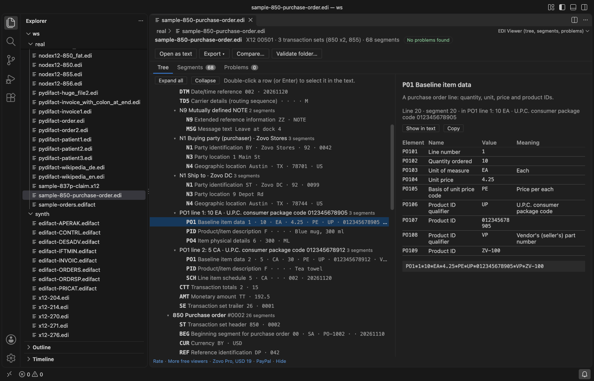
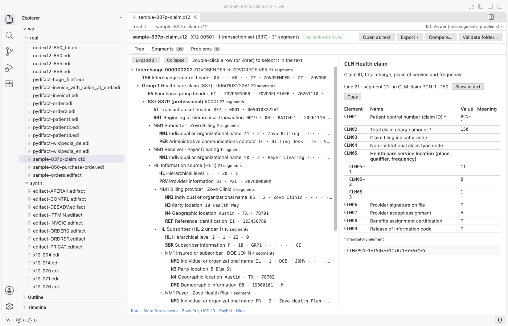
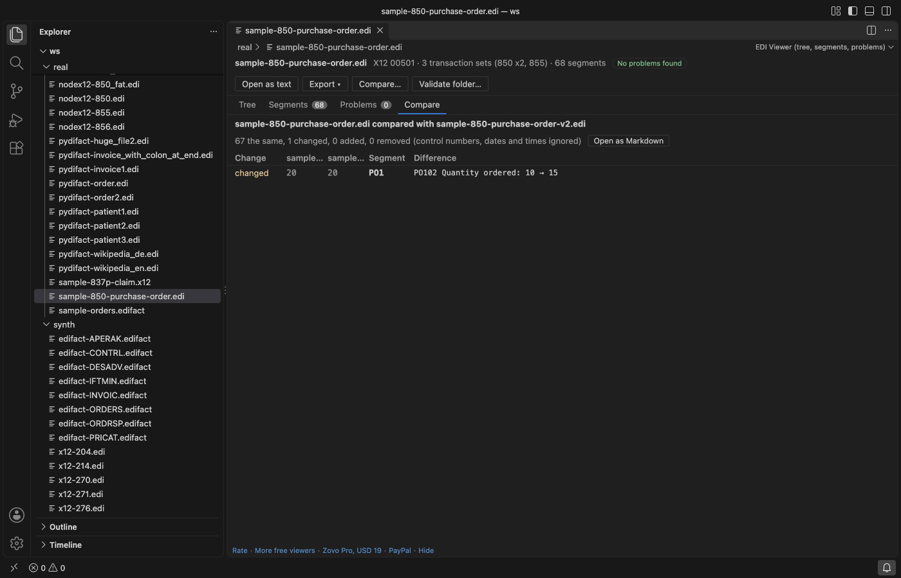

# EDI Viewer & X12 Viewer, EDIFACT Viewer for VS Code

Zovo Pro: USD 19 once, every Zovo tool

Open an X12 or EDIFACT file in VS Code and read it as a tree: interchanges, functional groups, transaction sets or messages, loops and segments, with the name of every element and the meaning of its codes. The viewer also checks control numbers, counts and mandatory elements. In the text editor you get colours, names on hover, problems in the Problems panel, and Format and Minify commands. No network, read-only.

## What you see

| | X12 | EDIFACT |
|---|---|---|
| Separators | read from the ISA header (element, repetition ISA11, component ISA16, segment terminator), with or without line breaks | read from UNA, or the defaults `:+.? '`; the release character `?` is honoured |
| Envelopes | ISA/IEA, GS/GE, ST/SE | UNB/UNZ, UNG/UNE, UNH/UNT |
| Loops | HL hierarchy (856, 837, 270, 271, 276, 277), NM1, N1, PO1, IT1, LIN, CLM, CLP, SVC, LX, S5 and more | segment groups: NAD, LIN, CPS, PAC, RFF, TDT, GID and more |
| Names | segments, elements and common code lists for 850, 855, 810, 856, 997, 999, 820, 837P, 837I, 835, 270, 271, 276, 277, 204, 214, 940, 945 | segments, composites, components and code lists for ORDERS, ORDRSP, DESADV, INVOIC, IFTMIN, PRICAT, APERAK, CONTRL |

- Tree tab: click a segment to see each element with its ID (for example `BEG03` or `NAD 02-1`), name, value and code meaning. Double-click (or Enter) selects the segment in the text editor next to the viewer; a click on an element row selects just that element.
- Segments tab: every segment with its line number and data, with a filter by segment ID or text.
- Problems tab: every problem with its line; a click shows the segment.
- Names are short descriptions written for this extension. EDIFACT names follow the public UN/CEFACT directories.

## What is checked

- X12: the width of each ISA field, ISA13 against IEA02, GS06 against GE02, ST02 against SE02, the number of functional groups (IEA01), transaction sets (GE01) and segments (SE01).
- EDIFACT: UNB05 against UNZ02, UNG05 against UNE02, UNH01 against UNT02, and the counts in UNZ01, UNE01 and UNT01.
- Segments that are not part of the transaction set or message type, segments outside an envelope, missing trailers, a duplicate control number in one group.
- Empty mandatory elements in the segments the dictionary knows.

## Text editor

- Files ending in `.edi`, `.x12`, `.edifact`, `.edf`, `.850`, `.810`, `.856`, `.837`, `.835` and other transaction numbers open as EDI text; files that start with `ISA`, `UNA` or `UNB` are found by their first line too.
- Hover: rest the mouse on a value to see its element ID, name and code meaning.
- Problems: the same checks as the viewer, shown in VS Code's Problems panel while you type.
- Format EDI (one segment per line) and Minify EDI (one line). Only the white space between segments changes; the segments stay byte for byte the same.

## Free and Pro

Everything above is free, with no limit and no sign-in. Three Zovo Pro tools save time on bigger jobs. Each has 3 free tries on your computer, and a try counts only when the tool gives you a result.

| Tool | Free | Zovo Pro |
|---|---|---|
| Tree, segments, problems, names, hover, format, minify | yes | yes |
| Export to JSON (a tree per transaction with element names) or CSV (line items of 850, 810, 856, ORDERS, INVOIC, DESADV; one row per segment for other types) | 3 tries | yes |
| Compare two EDI files segment by segment: added, removed and changed segments with the elements that differ; can ignore control numbers, dates and times; Markdown report | 3 tries | yes |
| Validate a folder: every X12 and EDIFACT file checked, one report with errors, warnings, counts and trading partners (ISA06/ISA08, UNB sender and recipient), as Markdown and CSV | 3 tries | yes |

Zovo Pro is USD 19 once and turns on the Pro tools in every Zovo extension. Nothing about Pro shows when you open a file; it only comes up when you click one of the three tools. To hide the buttons, set `ediViewer.showProTools` to `false`.

## Safe with any file

- The file is read in a separate worker thread with a time and memory limit. A broken or hostile file gives a message; it cannot freeze VS Code.
- Files up to 64 MB open in the viewer; up to 500,000 segments are shown. Every value is shown as text, never as HTML.
- Read-only: the viewer never writes to the file.
- No network and no telemetry.

## Commands

| Command | What it does |
|---|---|
| EDI Viewer: Open in EDI Viewer | Open any file in the viewer (also in the Explorer right-click menu and the editor title bar) |
| EDI Viewer: Format EDI (one segment per line) | One segment on each line |
| EDI Viewer: Minify EDI (one line) | All segments on one line |
| EDI Viewer: Open a sample X12 purchase order | A small sample to try the viewer |
| EDI Viewer: Export EDI to JSON (Pro) | Save the parsed file as JSON |
| EDI Viewer: Export EDI to CSV (Pro) | Save line items or segments as CSV |
| EDI Viewer: Compare two EDI files (Pro) | What changed between two files |
| EDI Viewer: Validate a folder of EDI files (Pro) | Check every EDI file of a folder |

## Settings

| Setting | Default | |
|---|---|---|
| `ediViewer.validate` | `true` | Problems in the text editor |
| `ediViewer.hover` | `true` | Names on hover |
| `ediViewer.showProTools` | `true` | Show the three Pro buttons |
| `ediViewer.showSupportLinks` | `true` | Small links at the bottom of the viewer |
| `ediViewer.askForRating` | `true` | Ask once, after a few days of use, for a rating |

## Support Zovo

Zovo Pro: USD 19 once, every Zovo viewer. [Get Zovo Pro on GitHub Sponsors](https://github.com/sponsors/theluckystrike/sponsorships?tier_id=679878) to turn on the Pro tools in this extension and in the other Zovo extensions you use. The free features stay free.

Zovo extensions have no ads and no tracking. They are made by [theluckystrike](https://github.com/theluckystrike) on GitHub. You can also support the work with no Pro:

- [Sponsor on GitHub](https://github.com/sponsors/theluckystrike)
- [PayPal](https://www.paypal.com/paypalme/najzzz)
- [Follow theluckystrike on GitHub](https://github.com/theluckystrike)

### Need your format supported?

Open a [format request](https://github.com/theluckystrike/edi-viewer-vscode/issues/new?template=format-request.yml) with a sample file, and I reply there whether it can be done. For USD 299 once, through [this GitHub Sponsors tier](https://github.com/sponsors/theluckystrike/sponsorships?tier_id=679995), I add your file format or a missing feature to this extension, with tests, within 7 days.

## More tools by Zovo

- [Hex Viewer & Binary Viewer, Hex Editor (Large Files)](https://marketplace.visualstudio.com/items?itemName=zovo.zovo-hex-viewer) opens binary files of any size, with find, a data inspector and byte editing.
- [SQLite Editor & Viewer, SQLite3 Database Browser (Edit Cells, CSV Import)](https://marketplace.visualstudio.com/items?itemName=zovo.sqlite-table-viewer) browses SQLite tables read-only and runs SELECT queries.
- [MongoDB Client & MongoDB GUI: Query, Edit Documents, Aggregation & Indexes](https://marketplace.visualstudio.com/items?itemName=zovo.zovo-mongodb-client) queries and edits MongoDB documents in a grid or as JSON.
- [Oracle SQL & SQL Server Query Client (MSSQL, T-SQL, PLSQL, Oracle Database Tool)](https://marketplace.visualstudio.com/items?itemName=zovo.zovo-oracle-sqlserver-client) runs Oracle SQL and T-SQL and browses tables.
- [Postgres & MySQL Query Client - SQL Database Tool (SQLite, CSV Export)](https://marketplace.visualstudio.com/items?itemName=zovo.zovo-sql-client) runs Postgres and MySQL queries, edits rows and exports CSV.

See [all Zovo extensions on the Marketplace](https://marketplace.visualstudio.com/publishers/zovo).

## More from zovo

- [All free zovo VS Code extensions](https://marketplace.visualstudio.com/publishers/zovo) — file viewers, database clients, formatters. Offline, no telemetry, no sign-up.
- [Full MCP server catalogue](https://theluckystrike.github.io/mcp/) — local-first MCP servers for back-office work: invoices, VAT, PDFs, spreadsheets, payroll.
- [Hosted no-install MCP endpoints](https://mcp.zovo.one) — paste a URL in Claude / Cursor, nothing to install.
